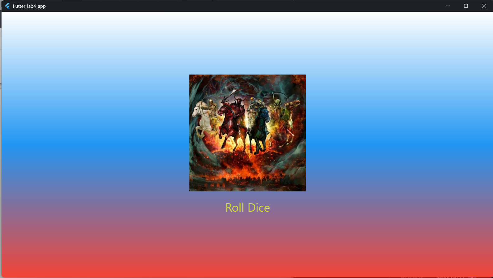

# Лабораторная работа №4-5. Flutter: структура UI и компонентный подход.

**ФИО: Вайнбендер Артём Алексеевич**
**Группа: ИСП-241**
**Дата сдачи: 15.10.2026**

## Что изучили:

1. Изучили разницу между StatelessWidget и StatefulWidget.
2. Научились управлять состоянием интерфейса с помощью setState().
3. Реализовали генерацию случайных чисел для игры в кости.

## Скриншот финального приложения:

## Ссылка на репозиторий:

[GitHub]()

## Инструкция по запуску:

1. Склонируйте репозиторий.
2. Выполните `flutter pub get` для установки зависимостей.
3. Запустите приложение командой `flutter run`.

## Ответы на вопросы:

1. Улучшается читаемость кода, упрощается навигация и появляется возможность переиспользовать компоненты. Если держать всё в `main.dart`, файл разрастется до тысяч строк, в нем будет сложно искать ошибки и вносить изменения.
2. Это объект с информацией о месте виджета в дереве. Flutter передает его автоматически. Он нужен, чтобы виджет мог получать данные от родительских элементов.
3. `StatelessWidget` отрисовывается один раз и не меняется. `StatefulWidget` хранит состояние и может перерисовываться при его изменении через `setState()` (например, счетчик, чекбокс, игральная кость).
4. Если создавать `Random()` внутри функции, которая вызывается при каждом нажатии кнопки, будет создаваться новый генератор случайных чисел. Это неэффективно. Создание одного глобального объекта Random на уровне файла позволяет использовать его повторно.
